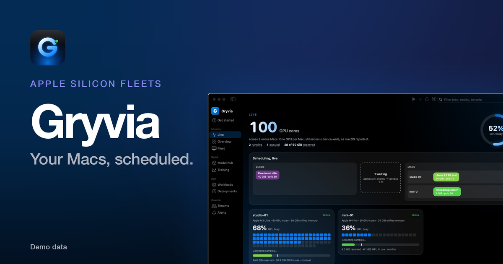
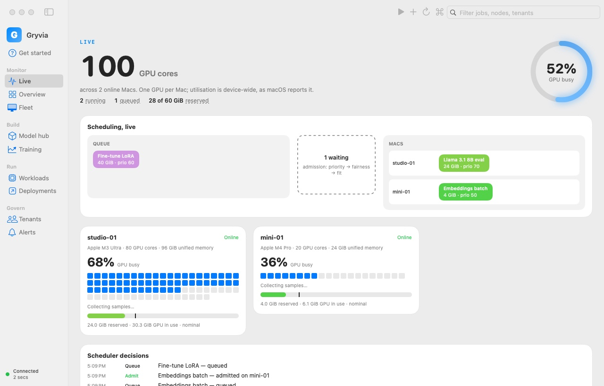
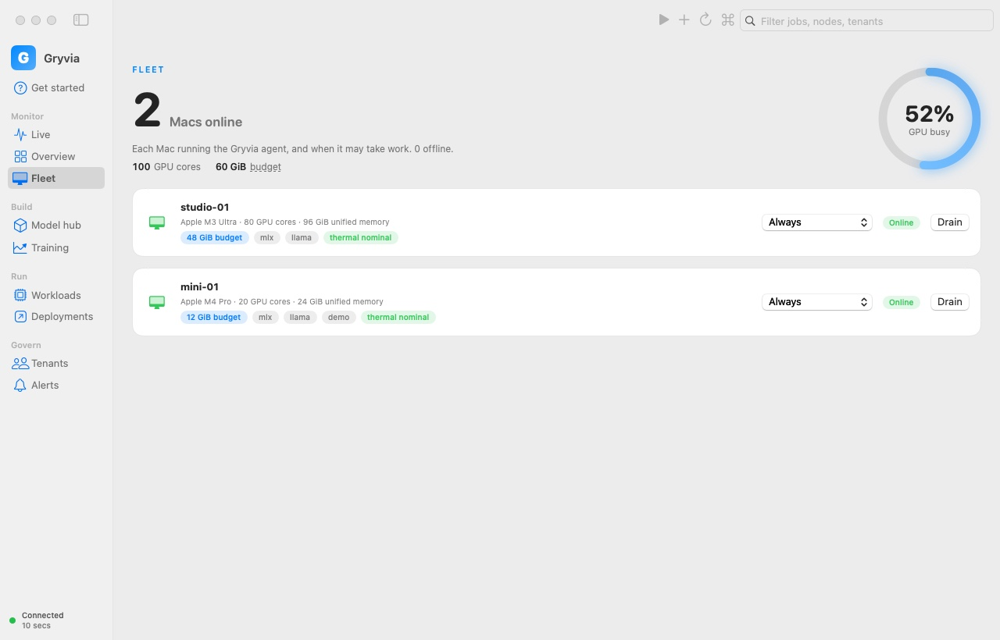
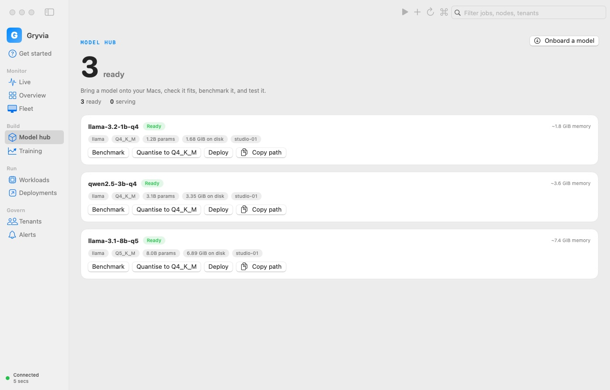

# Gryvia Apple

### Your Macs, scheduled.

**A control plane for Apple silicon fleets.** Memory-aware admission, quotas, live GPU cores and signed provenance, in a notarized Mac app.

[Website](https://zyvorai.github.io/gryvia-apple/) · [Getting started](docs/GETTING-STARTED.md) · [User guide](docs/USER-GUIDE.md) · [FAQ](docs/FAQ.md) · [Security](SECURITY.md) · [Changelog](CHANGELOG.md)

## Download the 30-day trial

**[Download Gryvia-0.5.2.dmg](https://github.com/zyvorai/gryvia-apple/releases/download/v0.5.2/Gryvia-0.5.2.dmg)** ([release page](https://github.com/zyvorai/gryvia-apple/releases/tag/v0.5.2)). Developer ID signed and notarized.

- macOS 15 or later, Apple silicon.
- **Free 30-day trial key: sales@zyvor.dev**
- SHA-256: `a1e406d73bffd4492f4876f577b498ffc4bb0a1a26b46d71775ae06dd4d8251d`
- Verify: `shasum -a 256 -c Gryvia-0.5.2.dmg.sha256` (the checksum file is attached to the release).

## Screenshots

<table>
<tr>
<td></td>
<td></td>
<td></td>
</tr>
<tr><td align="center">Live</td><td align="center">Fleet</td><td align="center">Model hub</td></tr>
</table>

Demo data on a simulated fleet, not a real one.

## Features

- **Memory-aware admission:** jobs are placed against each Mac's unified-memory budget, with priorities, tenant quotas and fairness weights.
- **Live fleet view:** GPU cores lit by measured utilisation, thermal state, drain and resume, alerts.
- **Owner-aware Macs:** run only when idle, yield when the owner returns, respect battery, Low Power Mode and calls.
- **One endpoint:** an OpenAI-style gateway with streaming, replicas on several Macs and one failover before the first byte.
- **Signed provenance:** node-signed attestations and verified chains for model artifacts.
- **Model workbench:** onboard from Hugging Face with a size cap and SHA-256, benchmark, evaluate, fine-tune with MLX LoRA, sweep a grid.
- **MCP server and Shortcuts actions** (read-only by default).

## Requirements

macOS 15 or later on Apple silicon. A second Mac is optional.

## Trial and licence

Free 30-day trial key: sales@zyvor.dev. Licences and plans: https://zyvor.dev/buy. The licence text is in [LICENSE](LICENSE); see also [docs/COMMERCIAL-LICENSE.md](docs/COMMERCIAL-LICENSE.md).

## Honest limits

One GPU per Mac; GPU utilisation is device-wide, not per job; reservations are admission bookkeeping, not isolation; energy is an estimate; training is single-Mac LoRA; there is no sandbox around runtimes, so enrol only Macs you would let an admin run code on. Replicas across two physical Macs are not yet measured. See [SECURITY.md](SECURITY.md).

## Docs

[Getting started](docs/GETTING-STARTED.md) · [User guide](docs/USER-GUIDE.md) · [FAQ](docs/FAQ.md) · [Commercial licence](docs/COMMERCIAL-LICENSE.md) · [Security](SECURITY.md) · [Changelog](CHANGELOG.md)

This repository holds the documentation, the website and the downloads. **The Gryvia Apple source code is private.**
